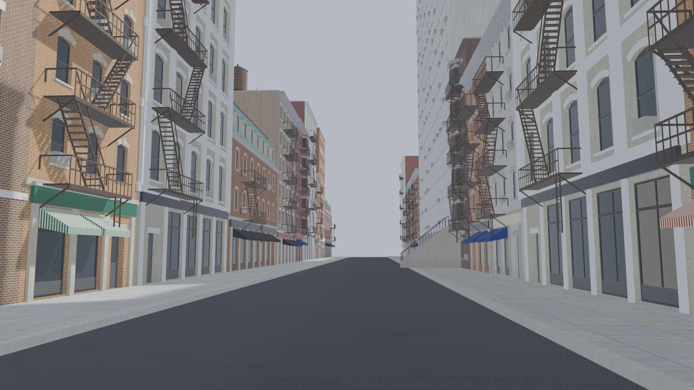
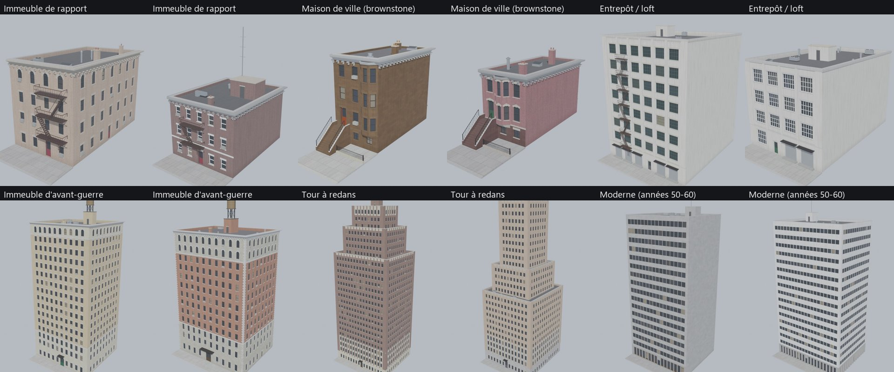
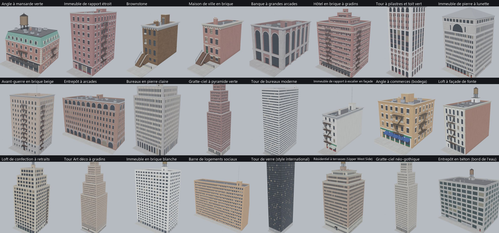
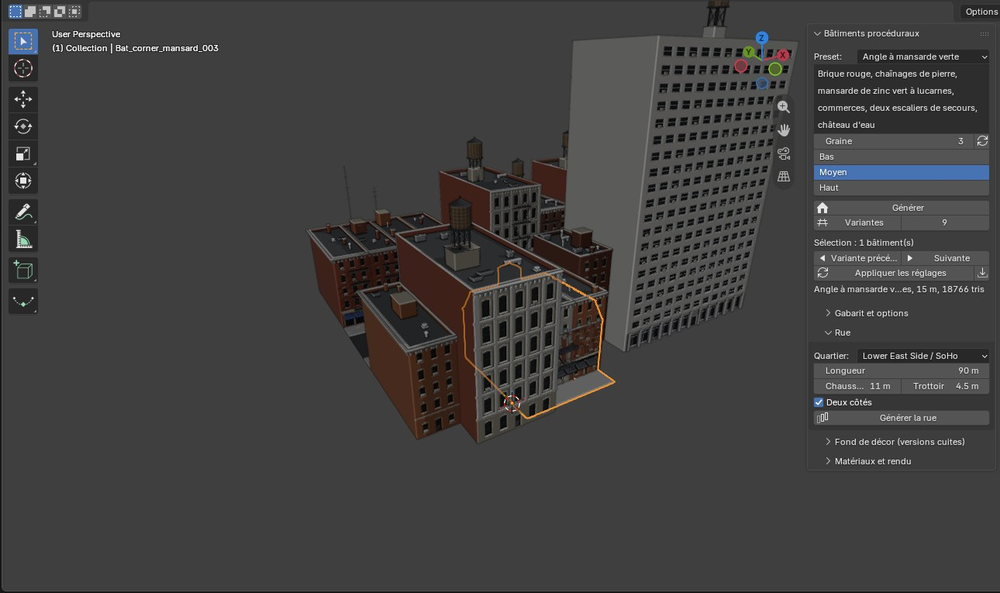
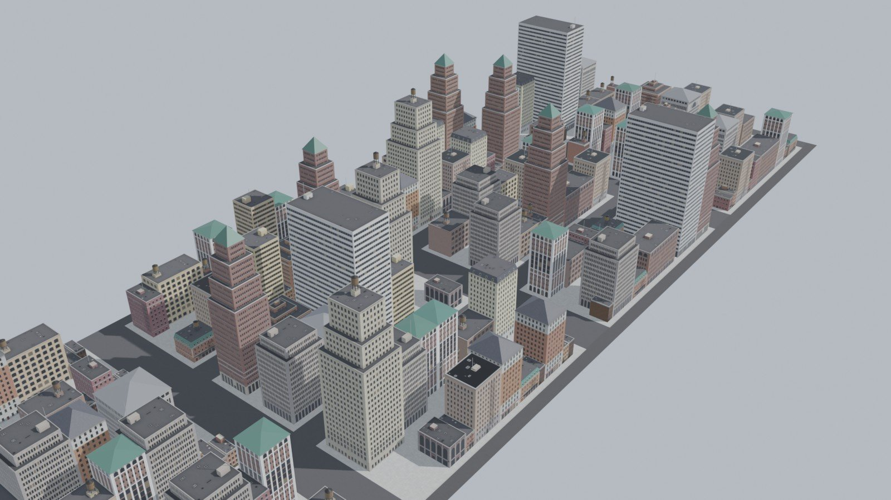
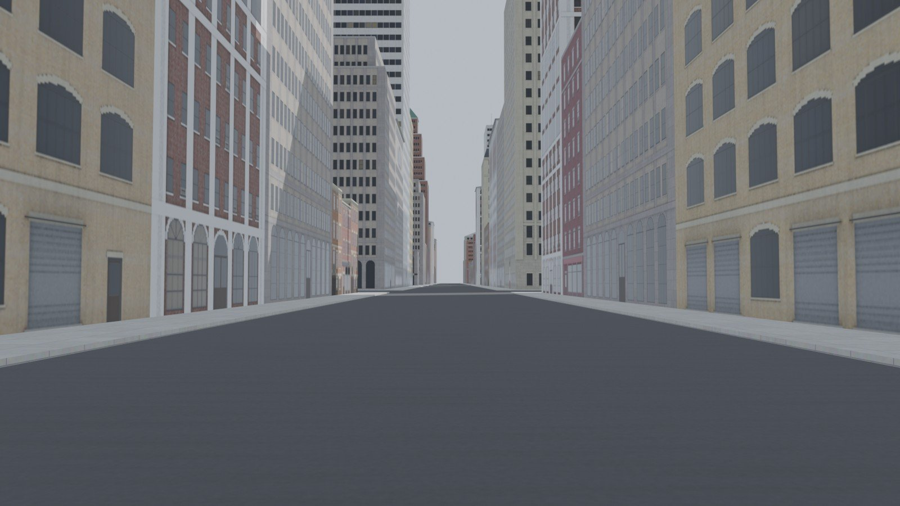

# Bâtiments procéduraux

Extension Blender (4.2 et plus, testée sur 5.3) qui génère des bâtiments new-yorkais du début du XXe siècle, dans l'esprit du kit Kitbash3D *Brooklyn* : immeubles de rapport en brique, maisons de ville à perron, entrepôts, immeubles d'avant-guerre, tours à redans et immeubles modernes. Elle génère aussi leurs variantes, des rues entières et des villes de fond de décor légères, aux textures cuites.



Tout est modélisé par le code, en vraie géométrie et sans booléen :

- **Fenêtres** : en retrait, avec tableaux, menuiseries (guillotine, petits bois, vitrines), appuis, linteaux, clés de voûte et arcs en plein cintre ou segmentaires.
- **Façade** : bandeaux, pilastres, chaînages d'angle, bossages, corniches à consoles et denticules, acrotères avec couvertine.
- **Toits** : plats, mansardés avec lucarnes, ou en croupe.
- **Accessoires de toit** : châteaux d'eau, édicules, clims, ventilations, antennes, lanterneaux, cheminées.
- **Façade et rez-de-chaussée** : escaliers de secours, bow-windows, devantures avec enseignes et auvents, perrons, quais de chargement, clims de fenêtre.
- **Équipements** (1.5) : descentes d'eau pluviale avec boîte à eau, colliers et dauphin, grilles de ventilation, sorties de sèche-linge, compteurs et conduits, gaines d'extraction de restaurant sur les façades arrière, colonnes de ventilation et gaines sur les toits, fenêtres condamnées.
- **Usure** (1.5) : salissure au pied des murs, coulures, crasse des recoins, salpêtre, rouille, taches au sol, rugosité variable ; tags, affiches collées, coulures sous les appuis, fissures et vieilles publicités peintes, dessinés par le code.

Aucun maillage ni texture du kit Kitbash3D n'est inclus. Toutes les images de cette page sont rendues avec les matériaux procéduraux de l'extension.

## Styles



| Style | Gabarit | Signes distinctifs |
|---|---|---|
| Immeuble de rapport | 3 à 6 étages | Brique, guillotines, corniche à consoles, escalier de secours, commerces |
| Maison de ville (brownstone) | 3 à 4 étages, 5,5 à 7,5 m de large | Perron, étage noble, bow-window, courette |
| Entrepôt / loft | 4 à 8 étages, large | Pilastres, baies à petits carreaux, quais, château d'eau |
| Immeuble d'avant-guerre | 8 à 16 étages | Soubassement à bossages, bandeaux, attique cintré, mansarde possible |
| Tour à redans | 18 à 40 étages | Retraits successifs, pilastres verticaux, antenne |
| Moderne (années 50-60) | 6 à 22 étages | Fenêtres en bandeau, rez-de-chaussée vitré |

Chaque style tire tous ses paramètres de la **graine** : gabarit, nombre de travées, matériaux, type de fenêtre, rez-de-chaussée, corniche, toiture, accessoires. Une même graine redonne toujours le même bâtiment.

## Presets



Les presets sont des bâtiments-types à silhouette fixe, inspirés des grands archétypes de Brooklyn et de Manhattan. Ils figent le gabarit, les matériaux, la trame et les ouvertures. La graine ne fait plus varier que les détails : équipements de toit, emplacement des portes et des escaliers de secours, clims, teinte (certains presets tirent aussi leur brique ou leur peinture parmi deux ou trois couleurs). Les réglages **Étages**, **Largeur** et **Profondeur** restent pris en compte (0 = valeurs du preset).

| Preset | Gabarit | Signes distinctifs |
|---|---|---|
| Angle à mansarde verte | 4 niveaux, 20 × 18 m | Brique rouge, chaînages de pierre, mansarde de zinc vert à lucarnes, commerces à auvents, château d'eau |
| Immeuble de rapport étroit | 8 étages, 12,6 m | Brique rouge, bandeaux gris, escalier de secours latéral |
| Brownstone | 4 niveaux, 6,1 m | Grès brun à bossages, perron, linteaux à clé, corniche en tôle |
| Maison de ville en brique | 4 niveaux, 7 m | Brique sur soubassement de grès, perron, bandeaux de pierre |
| Banque à grandes arcades | 2 niveaux, 14,4 m | Baies cintrées de 7 m entre pilastres de pierre, rez-de-chaussée vitré |
| Hôtel en brique à gradins | 12 étages, 30 × 26 m | Bandeaux crème, deux retraits en couronnement, deux escaliers de secours |
| Tour à pilastres et toit vert | 13 étages, 18,6 m | Pilastres clairs sur toute la hauteur, étages vitrés, attique cintré, croupe en zinc vert |
| Immeuble de pierre à lunette | 11 étages, 28 m | Fenêtres à petits bois, attique à double hauteur avec lunette de 9 m, toit en croupe |
| Avant-guerre en brique beige | 11 étages, 24 m | Socle à bossages, attique cintré, haute frise, deux escaliers de secours |
| Entrepôt à arcades | 7 étages, 45 m | Baies à petits carreaux, dernier étage cintré, arcades au rez-de-chaussée |
| Bureaux en pierre claire | 14 étages, 28 m | Pilastres, arcades sur double hauteur, attique en retrait |
| Gratte-ciel à pyramide verte | 27 étages, 107 m | Trois retraits, colonnade de pierre au pied, pyramide de zinc vert |
| Tour de bureaux moderne | 28 étages, 30 × 54 m | Panneaux blancs, fenêtres en bandeau, rez-de-chaussée vitré |
| Immeuble de rapport à escalier en façade | 5 étages, 7,8 m | 3 travées, escalier de secours sur la rue, corniche en tôle à consoles, commerce à auvent (Lower East Side) |
| Angle à commerces (bodega) | 4 étages, 15 × 16,5 m | Brique peinte, enseignes et auvents, escaliers de secours sur les deux rues |
| Loft à façade de fonte | 6 étages, 15,3 m | Colonnes peintes, entablement à chaque étage, hautes baies cintrées, flanc de brique, château d'eau (SoHo) |
| Loft de confection à retraits | 18 étages, 30 m | Brique beige, baies industrielles à petits carreaux, deux retraits, château d'eau (Garment District) |
| Tour Art déco à gradins | 36 étages, 36 m | Brique chamois, piliers en rayures verticales, cinq gradins, mât |
| Immeuble en brique blanche | 20 étages, 40 × 22 m | Années 60, longues fenêtres à cadre alu, clims, château d'eau |
| Barre de logements sociaux | 14 étages, 58 × 14 m | Brique orangée, trame répétitive, sans corniche |
| Tour de verre (style international) | 38 étages, 32 × 46 m | Mur-rideau sombre, colonnade de pierre au pied, écran technique |
| Résidentiel à terrasses (Upper West Side) | 17 étages, 30 m | Socle à bossages, marquise, gradins en terrasses, attique cintré, château d'eau |
| Gratte-ciel néo-gothique | 30 étages, 26 m | Pierre claire, piliers continus du sol au sommet, baies cintrées, flèche de cuivre vert |
| Entrepôt en béton (bord de l'eau) | 9 étages, 48 m | Ossature béton, grandes baies d'acier, quais de chargement, château d'eau |

Tous les presets sont générés par le code de l'extension : aucun modèle du kit n'est repris.

## Installation

1. Ouvrez **Édition › Préférences › Get Extensions**.
2. Dans le menu **⌄** en haut à droite, choisissez **Install from Disk…**, puis sélectionnez `procedural_buildings-X.Y.Z.zip` téléchargé depuis la [dernière release](https://github.com/lburdier/procedural-buildings/releases/latest).
3. Le panneau se trouve dans **Vue 3D › barre latérale (N) › onglet Bâtiments**.



## Mises à jour automatiques

À partir de la 1.4.0, l'extension cherche une nouvelle version sur les [releases GitHub](https://github.com/lburdier/procedural-buildings/releases) au démarrage de Blender, une fois par jour au plus. Si elle en trouve une, elle la télécharge, vérifie sa taille et son empreinte sha256, puis l'installe avec l'installeur d'extensions de Blender.

- Les réglages sont dans les préférences de l'extension : **Chercher les mises à jour**, **Installer automatiquement** (sinon un bouton apparaît en haut du panneau) et le bouton **Chercher une mise à jour**.
- Rien n'est envoyé : une simple requête GET à l'API GitHub. Le réglage **Allow Online Access** de Blender est respecté.
- Côté dépôt, chaque poussée sur `main` dont le `blender_manifest.toml` porte une nouvelle version crée la release `vX.Y.Z` avec le zip de l'extension (workflow `.github/workflows/release.yml`).

## Utilisation

- **Preset** : *Aucun* pour un style libre, ou l'un des 24 bâtiments-types ci-dessus.
- **Générer** : crée un bâtiment au curseur 3D.
- **Variantes** : crée une grille de N bâtiments du même style, avec des graines successives.
- **Variante précédente / suivante** (sur la sélection) : change la graine sans déplacer le bâtiment.
- **Appliquer les réglages** : régénère la sélection avec les réglages du panneau (style, étages, options), en gardant la graine.
- **Générer la rue** : crée deux rangées de bâtiments mitoyens, avec trottoirs, bordures et chaussée. Sept quartiers sont proposés : Brooklyn mixte, résidentiel, industriel, centre, *Catalogue de presets* (rangées composées des presets de petite et moyenne taille), *Lower East Side / SoHo* (immeubles de rapport à escalier en façade, bodegas, lofts en fonte) et *Midtown* (lofts de confection, tours Art déco, néo-gothiques et de verre, résidentiels à terrasses). Les murs mitoyens sont aveugles, et les maisons à perron sont reculées derrière une courette.
- **Gabarit et options** : étages, largeur et profondeur (0 = au hasard), rez-de-chaussée, toit, mur, escaliers de secours, château d'eau, équipements de toit, commerces, auvents, clims de fenêtre.
- **Détail** :
  - *Bas* pour le lointain ;
  - *Moyen* par défaut ;
  - *Haut* pour le premier plan, avec petits bois, barreaux et denticules.

  Ordre de grandeur en détail moyen : maison de ville environ 5 000 triangles, immeuble de rapport 8 000 à 18 000, tour 50 000 à 120 000.
- **Échelle (u/m)** : unités de scène par mètre (par exemple 1,68 pour le plan 1 de TAKUMI).
- **Fenêtres allumées** : force et proportion des fenêtres éclairées, pour la nuit.
- **Usure** : force globale du vieillissement de tous les matériaux (0 : neuf). Chaque bâtiment varie un peu autour de cette valeur.
- **Tags et affiches** : densité des décalcomanies (0 : aucune).
- **Tuyaux et ventilations** : active les équipements de façade et de toit.

### Catalogue à glisser-déposer

Le panneau **Catalogue (glisser-déposer)** construit, en arrière-plan (2 à 4 minutes), une bibliothèque d'assets avec tous les presets et tous les styles, en plusieurs variantes, chacun avec sa vignette. Ils sont rangés en catalogues *Brooklyn*, *Manhattan* et *Styles*. La bibliothèque est déclarée dans **Préférences › Fichiers › Bibliothèques d'assets** et s'importe en mode *Ajouter*.

1. **Construire le catalogue** (une fois, puis **Mettre à jour** après un changement de réglages).
2. **Ouvrir l'explorateur d'assets** : ouvre l'explorateur sous la vue 3D, sur la bibliothèque *Bâtiments procéduraux*.
3. Glisser un bâtiment dans la scène : il se pose sous la souris. Il reste un bâtiment généré : graine, variantes et réglages s'appliquent depuis le panneau.

Le catalogue est écrit dans le dossier utilisateur de l'extension. Il reprend le détail et les matériaux du panneau. Avec les textures Kitbash3D, les textures restent liées depuis votre dossier et ne sont pas copiées.

Les paramètres de chaque bâtiment sont stockés dans l'objet (propriétés `bg_params` et `bg_info`). On peut donc toujours le régénérer.

## Fond de décor (versions cuites)





Pour les arrière-plans, chaque bâtiment peut être remplacé par une **version de fond**. C'est un volume simplifié de 10 à 120 triangles qui garde la silhouette : retraits, mansarde, croupe, édicules et château d'eau. Ses textures sont cuites (Cycles) depuis le bâtiment détaillé :

| Image | Contenu |
|---|---|
| `_couleur` | Couleur de base des matériaux, sans éclairage |
| `_normales` | Normales en espace tangent : fenêtres en creux, corniches, bandeaux, escaliers de secours en relief |
| `_ao_rugo` | Occlusion ambiante (rouge) et rugosité (vert) : vitres brillantes, murs mats |

Chaque face a sa propre île UV, sans étirement, et toutes les faces ont la même densité de pixels. La résolution (une puissance de 2) est calculée pour atteindre la **densité** demandée, en pixels par mètre (12 par défaut). Les copies d'un même bâtiment partagent maillage et images. La teinte varie légèrement d'une copie à l'autre.

Le panneau **Fond de décor** propose trois actions :

1. **Version de fond de la sélection** : cuit les bâtiments sélectionnés, place leur version de fond au même endroit et masque les détaillés.
2. **Créer la bibliothèque** : tire et cuit N bâtiments uniques (32 par défaut) d'un quartier :
   - *New York mixte* ;
   - *Manhattan*, avec gratte-ciel à retraits, tours Art déco, néo-gothiques et de verre, lofts de confection, bureaux, hôtels et résidentiels à terrasses ;
   - *Brooklyn*, avec immeubles de rapport, bodegas, brownstones, entrepôts de brique et de béton, angles à mansarde et logements sociaux.

   Comptez 3 à 18 s par bâtiment sur GPU avec les matériaux procéduraux, 13 à 35 s avec les textures du kit.
3. **Créer la ville de fond** : quadrillage de blocs new-yorkais, avec la longueur et la profondeur des blocs, la largeur des rues et des avenues, et un sol. Les blocs sont bordés de copies liées des modèles de la bibliothèque. Le réglage **Skyline** regroupe les tours au centre.

Les images sont enregistrées dans `//textures_fond/`, à côté du `.blend`. Si le fichier n'est pas encore enregistré, elles sont empaquetées dedans. La cuisson utilise le GPU s'il est activé dans **Préférences › Système › Cycles**, sinon le CPU.

Ordre de grandeur mesuré : une ville de 5 × 4 blocs compte 328 bâtiments et 11 600 triangles. Elle s'appuie sur 32 modèles, soit 96 images de 512 à 2048 px (environ 340 Mo en mémoire). La bibliothèque se cuit en 10 min sur une GTX 1660 avec les textures du kit, et la ville se place en moins d'une seconde.

## Matériaux

- **Procéduraux** (par défaut, autonomes) :
  - brique à joints, avec teinte variable d'un bâtiment à l'autre ;
  - brique blanche émaillée, brique orangée, allèges de métal sombre pour les murs-rideaux ;
  - pierre appareillée, pierre gris chaud, béton, zinc à joints debout, ardoise ;
  - vitres légèrement différentes d'une fenêtre à l'autre, certaines avec rideau ;
  - usure partagée par tous les matériaux (groupes de nœuds `BG_usure_*`) : pied de mur sali, coulures verticales, crasse des recoins (occlusion ambiante), grandes taches qui cassent la répétition, salpêtre sur la brique, rouille des métaux et des escaliers de secours, chewing-gums, taches d'huile et flaques sur les trottoirs et les toits, poussière sur les vitres. La rugosité varie avec la saleté et les coulures.
- **Décalcomanies** : atlas de 2048 px dessiné par l'extension et empaqueté dans le `.blend`. Il contient des tags calligraphiés avec coulures, des murs d'affiches déchirées, des autocollants, des coulures d'eau et de rouille, des fissures et une vieille publicité peinte. Les décalques sont posés à 6 mm du mur, sur des zones libres, et ne sont pas cuits dans les versions de fond.
- **Textures Kitbash3D** : si vous possédez le kit *Brooklyn*, indiquez son dossier `KB3DTextures` dans les préférences de l'extension ou dans le panneau. Les matériaux utilisent alors les textures PBR 4K du kit, avec une tuile de 3,66 m (12 pieds, l'échelle du kit). Ces textures sont lues sur votre disque et ne sont jamais copiées dans l'extension.
- **Basculer les matériaux** : passe tous les bâtiments générés d'un mode à l'autre. Les matériaux d'une scène créée avec une version précédente sont reconstruits avec l'usure.

## Géométrie propre

Depuis la version 1.5, un contrôle automatique vérifie les 24 presets et les 6 styles, en plusieurs graines, détails et mitoyennetés. Il cherche les faces superposées (scintillement) et les pièces qui se traversent. Les corrections portent sur la génération elle-même :

- les fenêtres, leurs appuis, linteaux et arcs s'écartent des pilastres, des bandeaux et de la zone de corniche ;
- les pilastres s'arrêtent sous la corniche ;
- les bandeaux ne débordent plus chez le voisin, et seul l'un des deux côtés d'un angle le remplit ;
- consoles et denticules évitent les pilastres et se placent sous la vraie corniche, mansarde et croupe comprises ;
- l'escalier de secours se tient devant les pilastres, bandeaux et enseignes. Il est fixé par des pattes, suspendu par des tirants au-dessus des devantures, et son échelle reste au-dessus des auvents ;
- le château d'eau est posé sur l'édicule, les bossages contournent les arcs voisins, et le trottoir ne recouvre plus la courette.

## Script (batch)

```python
import procedural_buildings.layout as L
ob, info = L.create_building(bpy.context, dict(style='walkup', seed=12, opts={'floors': 5}, detail=1, party=(False, False), sidewalk=True))
L.create_building(bpy.context, dict(style='walkup', preset='corner_mansard', seed=1, opts={}, detail=1, party=(False, False), sidewalk=True))
L.street(bpy.context, seed=3, length=150, mix='brooklyn')

import procedural_buildings.fond as F
lib = F.library(bpy.context, 'manhattan', count=24, seed=1, out_dir=bpy.path.abspath("//textures_fond"))
F.city(bpy.context, lib, blocks_x=6, blocks_y=4, seed=2, skyline=0.7)
ob, fi = F.bake(bpy.context, dict(style='tower', preset='setback_spire', seed=1, opts={}))   # un seul batiment
```

## Licence

GPL-3.0-or-later. Le nom *Kitbash3D* et le kit *Brooklyn* appartiennent à leurs auteurs : cette extension n'en reprend aucun fichier.
